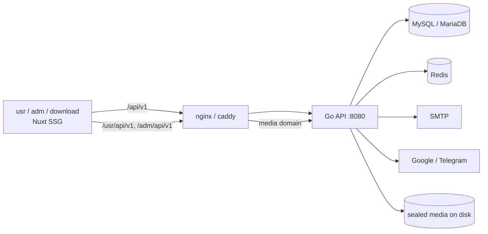

# codemgr

Full-stack scaffold for a multi-portal web product: a Go API, three Nuxt frontends, and a
single `main.sh` that owns init, build, and deploy.


---

## What's inside

| Layer | Stack | Where |
| :-- | :-- | :-- |
| API | Go 1.25 + Fiber v3 | `main.go`, `internal/srv/` |
| Persistence | GORM; MySQL/MariaDB by default (sqlite, postgres, sqlserver, clickhouse also supported) | `internal/db/` |
| Sessions | JWT access + refresh tokens, refresh IDs tracked in Redis | `internal/auth/` |
| Encryption at rest | AES-GCM sealing of account identifiers and media; HMAC blind indexes for lookups | `internal/crypt/` |
| Frontend — user | Nuxt 4, shadcn-vue, Tailwind v4, Tauri v2 shell | `web/apps/usr/` (:3000) |
| Frontend — admin | Nuxt 4, Vuetify, Tailwind v4 | `web/apps/adm/` (:3001) |
| Frontend — download | Nuxt 4, shadcn-vue | `web/apps/download/` (:3002) |
| API docs / SDK | swag → `docs/swagger.json` → alova/wormhole → typed SDK | `web/packages/apiclient/` |
| Shared Nuxt modules | Git submodule of optional modules (alova, i18n, infra, pinia, shadcn, vuetify, tauri, ...) | `web/packages/natholdallas/` |
| Ops | systemd (default) or tmux, nginx/caddy site config, per-server env builds | `main.sh`, `assets/` |



## Features

- **Two auth realms** — separate JWT secrets for users and admins; refresh-token IDs are
  tracked in Redis so sessions are revocable (`POST /auth/refresh`, `/auth/logout`). The
  SDK attaches the access token as a Bearer header and retries once on 401 via `$refresh()`.
- **User sign-up / sign-in** — password, emailed verification code, Google, Telegram.
  Sign-up and every code-sending endpoint is IP rate-limited.
- **Profile & bindings** — update profile, upload/remove avatar, change password, bind and
  unbind Google/Telegram identities.
- **Media library** — upload images/videos/files (configurable size caps), stored encrypted
  on disk, served through a `media-route` or a dedicated media domain.
- **End-to-end encrypted vault** — a per-user opaque envelope (WebCrypto on the client,
  optimistic concurrency via a version counter). The server never sees vault plaintext.
- **Sealed PII** — email, username, and OAuth profiles are AES-GCM sealed at rest with
  deterministic HMAC blind indexes, so unique lookups still work.
- **Admin console** — CRUD for users and admins, password resets, media management,
  aggregate stats (counts + vault bytes only).
- **Public config endpoint** — frontends fetch media base URL, upload limit, and enabled
  OAuth providers at runtime.
- **i18n, PWA, SEO toggles, light/dark theme** in the frontends (`ENABLE_PWA`, `ENABLE_SEO`).
- **Requests** — request IDs, panic recovery, exact-match CORS allowlists, rate limiting.
- **One-command deploy** — build once, rebuild frontends per server, ship to every entry in
  `servers[]`, restart the service, install nginx/caddy config.

---

## Requirements

- **Go** ≥ 1.25
- **Node.js** 22.19+ (24.11+ or 26+ also supported by Nuxt 4.5) and **pnpm** 12.21.0
  (`corepack enable` picks it up from `web/package.json`)
- **MySQL** / **MariaDB** (or another GORM driver)
- **Redis** — required; refresh-token storage lives there and the process refuses to boot
  without it
- **tmux** for `./main.sh dev`
- **rsync** (or `scp`) and SSH access for deploys

## Quick start

```bash
# submodules carry the shared Nuxt modules
git clone --recurse-submodules <repo> codemgr && cd codemgr

./main.sh init        # gowatch + swag, submodule init, swagger, SDK, go mod tidy, pnpm install
./main.sh copyfile    # assets/conf.toml -> conf.toml, assets/nuxt.env* -> each app

# generate the three 32-char secrets, then paste them into conf.toml
go build -o bin/backend . && ./bin/backend --gensec

# edit conf.toml: jwt.secret.adm, jwt.secret.usr, crypto.key, [db], [redis], [smtp]
./main.sh dev
```

`./main.sh dev` opens a tmux session with one window for `gowatch` (Go hot reload) and one
per app (`pnpm dev`), so user/admin/download run on ports 3000/3001/3002.

> `conf.toml` is gitignored and holds real secrets. `crypto.key` seals identifiers and media
> files; rotating it makes already-sealed rows and files unreadable, so every server sharing
> the database must use the same key.

Order of operations: `init → copyfile → edit conf.toml → dev`, then
`build → deploy`.

---

## `main.sh`

All configuration is a block at the top of the script. The registries drive every command —
no code changes are needed to add an app, server, or domain.

| Command | Purpose |
| :-- | :-- |
| `./main.sh init` | First-time setup: tools, submodules, swagger + SDK, `go mod tidy`, `pnpm install` |
| `./main.sh copyfile [--force]` | Copy config/env templates; `conf.toml` is only written when absent unless `--force` |
| `./main.sh dev [restart\|stop]` | Start/restart/stop the tmux dev session |
| `./main.sh build` | Backend + SDK, then every app for the **default** server |
| `./main.sh docs` | `swag fmt` + `swag init`, regenerate the frontend SDK |
| `./main.sh deploy` | Build once, then ship to **every** server in `servers[]` |
| `./main.sh servers` | List configured servers, apps, web server, domain bindings |
| `./main.sh synconf [server]` | Sync `conf.toml` to a server (default: first entry) |
| `./main.sh webconf [server]` | Render + install nginx/caddy config without redeploying |
| `./main.sh serverlog [server] [once\|lines]` | Tail or print the remote service log |
| `./main.sh clean` | Remove `node_modules`, `dist`, `.nuxt`, `.output` |
| `./main.sh push "msg"` | `git add -A`, commit, push |
| `./main.sh initremote [name] [--public]` | Create a GitHub repo, bind `origin`, set upstream (never pushes) |
| `./main.sh renewal <name>` | Rename the whole project and reset git — **irreversible** |

### Deploy flags

| Flag | Effect |
| :-- | :-- |
| `--skip-build` | Reuse existing artifacts; warns if `dist/.built-for` names another server |
| `--force-service` | Overwrite an existing systemd unit (systemctl mode only) |
| `--allow-placeholder-env` | Allow shipping a bundle whose `NUXT_PUBLIC_API_BASE` is still `localhost` / `example.com` |

Deploy flow:

1. `swag init` → `go build` (∥ `pnpm gen:api`) once — backend and SDK are server-independent.
2. For each server: rebuild every frontend with that server's env, zip, rsync/scp, install
   the systemd unit (or restart the tmux session), health-check.
3. After a successful deploy, render and reload the nginx/caddy site config.

### Configuration block

```bash
pname=codemgr                    # unit / session / remote dir name
deploy_mode="systemctl"          # systemctl | tmux
use_rsync="${USE_RSYNC:-true}"   # true=rsync, false=scp
web_server="nginx"               # none | nginx | caddy
web_api_addr="127.0.0.1:8080"    # must match conf.toml app.port
client_max_body="20m"            # must match conf.toml app.body-limit
sudoers_name="webtplmstx"        # /etc/sudoers.d file — shared and fixed

apps=(                           # name|dir|build_cmd|out_dir
  "adm|web/apps/adm|pnpm generate|dist"
  "usr|web/apps/usr|pnpm generate|dist"
  "download|web/apps/download|pnpm generate|dist"
)
servers=(                        # name|ssh_user|host; first entry = default
  "prod|deploy-user|203.0.113.72"
)
declare -A app_env
app_env[prod:usr:NUXT_PUBLIC_API_BASE]=same-origin
app_env[prod:adm:NUXT_PUBLIC_API_BASE]=same-origin
app_env[prod:download:NUXT_PUBLIC_API_BASE]=same-origin

domains=(                        # endpoint|domain; empty = endpoint disabled
  "usr|example.com"
  "adm|mgr.example.com"
  "download|download.example.com"
  "api|"
  "media|"
)
app_bind=(                       # app|api_endpoint|site_endpoint
  "usr|api|usr"
  "adm|api|adm"
  "download|api|download"
)
```

- `deploy_mode` — `systemctl` installs into `/srv/http/$pname` and manages
  `/etc/systemd/system/$pname.service` (limited passwordless sudo via `sudoers_name`);
  `tmux` runs `./bin/backend` in a tmux session under `~/tasks/$pname`.
- `web_server` — `none` serves static files from the Go process; `nginx`/`caddy` render
  `assets/nginx/*` or `assets/caddy/*` for every non-empty endpoint in `domains[]`.
- `NUXT_PUBLIC_API_BASE` / `NUXT_PUBLIC_SITE_URL` are auto-derived from `domains[]` +
  `app_bind[]`; explicit `app_env` entries win. Use `same-origin` when frontends and API
  share one reverse-proxy host.
- Media is encrypted on disk, so it is always proxied to the backend — never served as a
  static directory.

---

## Configuration (`conf.toml`)

`assets/conf.toml` is the template.

| Section | Key | Notes |
| :-- | :-- | :-- |
| `app` | `name`, `port` | `port` must match `web_api_addr` |
| | `debug` | Enables the dev CORS list (also `cors.dev`) |
| | `nginx` | Set by `webconf`/`deploy` when `web_server != none` |
| | `body-limit` | MB; must be ≥ `resources.media-max-size` and `media-avatar-max-size` |
| | `swagger` | Serves Scalar UI at `/doc/api/v1` |
| `jwt` | `access-minutes`, `refresh-hours` | Access TTL, refresh TTL |
| `jwt.secret` | `adm`, `usr` | Required 32-char secrets; `--gensec` prints new ones |
| `crypto` | `key` | Required 32-char key; seals PII + media |
| `log` | `filename`, `max-size`, `max-backups`, `max-age`, `compress` | Lumberjack rotation |
| `cors` | `dev`, `prd` | **Exact** origins (scheme + host + port); no prefix matching |
| `resources` | `web`, `log`, `cache`, `media` | Paths served/created at boot |
| | `media-route`, `media-url` | Same-origin route, optional CDN/domain base |
| | `media-max-size`, `media-avatar-max-size` | MB |
| `db` | `driver`, `name`, `host`, `port`, `query`, `username`, `password` | `auto-migrate`, `auto-create` |
| `redis` | `host`, `port`, `index` | Required at boot |
| `smtp` | `host`, `port`, `from`, `password` | 465 implicit SSL, 587 STARTTLS, 25 plaintext |
| `oauth.google` | `enabled`, `client-id`, `client-secret`, `redirect-uri` | |
| `oauth.telegram` | `enabled`, `bot-token`, `bot-username` | |

---

## Backend CLI (`bin/backend`)

| Flag | Behavior | Data |
| :-- | :-- | :-- |
| `--gensec` | Print new JWT + crypto secrets; exits without touching config/DB | — |
| `--adm` / `--usr` | Interactively create an admin / user | Safe |
| `--mock` | Seed `admin`/`user` with password `123456` | Safe |
| `--db-create` | Create the database if missing | Safe |
| `--db-migrate` | GORM auto-migrate: create tables, add/alter columns (add-only) | Safe |
| `--db-sync` | Reconcile columns with models: add, **drop**, **reorder** | Dropped columns lose data |
| `--db-reset-table` | Recreate every table from its model | All data lost |
| `--db-reset` | Drop and recreate the whole database | All data lost |
| `--db-encrypt` | One-shot seal of existing plaintext identifiers and media files | Rewrites rows/files |

Models are registered in `internal/db/db.go` (`Models`), the single source of truth for
migrate/sync/reset. Every model uses full `gorm`/`json` tags, a `comment`, a trailing
comment, and embeds `orms.Model[uint]`.

---

## API

All routes are versioned under their own prefix.

| Realm | Prefix | Auth | Endpoints |
| :-- | :-- | :-- | :-- |
| Public | `/api/v1/` | — | `GET /config` |
| User | `/usr/api/v1/` | JWT | `auth/*` (signup, code, login, email login, refresh, logout, google, telegram), `profile/*` (me, password, avatar, bindings), `media/*`, `vault` |
| Admin | `/adm/api/v1/` | JWT | `auth/*` (login, refresh, logout), `user/*`, `admin/*`, `profile/*`, `media/*`, `stat` |

- Interactive docs: `/doc/api/v1` when `app.swagger = true`. The spec is always written to
  `docs/`.
- Responses assume fully populated 2xx schemas; error responses use a shared `Fail` DTO.
- Annotations live on handlers (`@ID` globally unique, `@Tags` carry the realm prefix,
  `@name` carries a `Usr`/`Adm` prefix for app-owned DTOs).

### Frontend SDK

`./main.sh docs` regenerates both swagger and the typed alova SDK:

```
swag init -> docs/swagger.json -> @alova/wormhole -> web/apps/*/app/lib/sdk/
```

Generated SDK files (`index.ts`, `createApis.ts`, `apiDefinitions.ts`, `globals.d.ts`,
`models.ts`) are gitignored. Change the API → edit annotations → run `./main.sh docs`.

---

## Project layout

```text
.
├── main.go                 # API entrypoint
├── main.sh                 # init / dev / build / deploy / ops
├── conf.toml               # local configuration (gitignored)
├── internal/
│   ├── srv/                # std (public), usr, adm, swg (Scalar UI)
│   ├── db/                 # GORM models, migration, mock, sealing backfill
│   ├── auth/               # JWT issue/rotate/revoke (Redis-backed)
│   ├── crypt/              # AES-GCM sealing + blind indexes
│   ├── conf/               # Viper config, validation, logger
│   ├── flag/               # CLI scripts dispatched from main()
│   ├── mail/               # SMTP client + HTML templates
│   ├── oauth/              # Google / Telegram
│   └── client/             # outbound HTTP clients
├── web/
│   ├── apps/{usr,adm,download}/
│   └── packages/
│       ├── apiclient/      # swagger -> alova SDK generator
│       └── natholdallas/   # shared Nuxt modules (submodule)
├── assets/                 # conf/env templates, nginx/caddy, systemd unit
├── docs/                   # generated swagger (gitignored)
└── scripts/lint.sh         # backend lint gate
```

---

## Development

```bash
# backend
gowatch -o bin/backend

# a single frontend
cd web/apps/usr && pnpm dev
```

Lint gates:

```bash
# backend: gofumpt, gci, go build, go vet, staticcheck, golangci-lint
./scripts/lint.sh          # check
./scripts/lint.sh --fix    # apply formatting

# frontend (from web/)
pnpm lint                  # every app's ESLint; fix all warnings and errors
pnpm lint:fix
pnpm format                # Prettier
cd web/apps/usr && pnpm typecheck
```

Tauri desktop builds for the user app:

```bash
cd web/apps/usr
pnpm dev:tauri
pnpm package
```

---

## Deployment notes

- The systemd unit is `assets/run.service` (`@PNAME@`, `@SRV_DIR@`); logs go to
  `journalctl -u <pname>` (`./main.sh serverlog`).
- `deploy` only uploads `conf.toml` when the remote has none (so it never overwrites
  production secrets). After editing the local config, run `./main.sh synconf [server]` and
  restart the service.
- nginx sites listen on `:80`; add TLS with `certbot --nginx`. Caddy does automatic HTTPS.
- `deploy` refuses a bundle still pointing at `localhost`/`example.com`; pass
  `--allow-placeholder-env` only for throwaway environments.
- If a deploy fails for a server, its web-server config is left untouched.

## Gotchas

| Symptom / situation | Cause & fix |
| :-- | :-- |
| Boot panics on Redis | Redis is required; check `[redis]` and start the server |
| Empty CORS response / blocked browser request | Origins are matched exactly; list scheme+host+port in `cors.prd` (or `cors.dev` in debug) |
| Existing data unreadable after deploy | `crypto.key` differs between servers — use the same key |
| Fresh clone won't compile | `docs/` is gitignored; run `./main.sh init` or `./main.sh docs` |
| Upload rejected before its own size check | `app.body-limit` must be ≥ media/avatar limits |
| `--skip-build` deployed wrong bundle | Check `dist/.built-for` warnings, rebuild for the target server |
| `swag --version` mismatch | Pinned to v2.0.0-rc5; reinstall with `go install github.com/swaggo/swag/v2/cmd/swag@v2.0.0-rc5` |

## License

[MIT](LICENSE)
